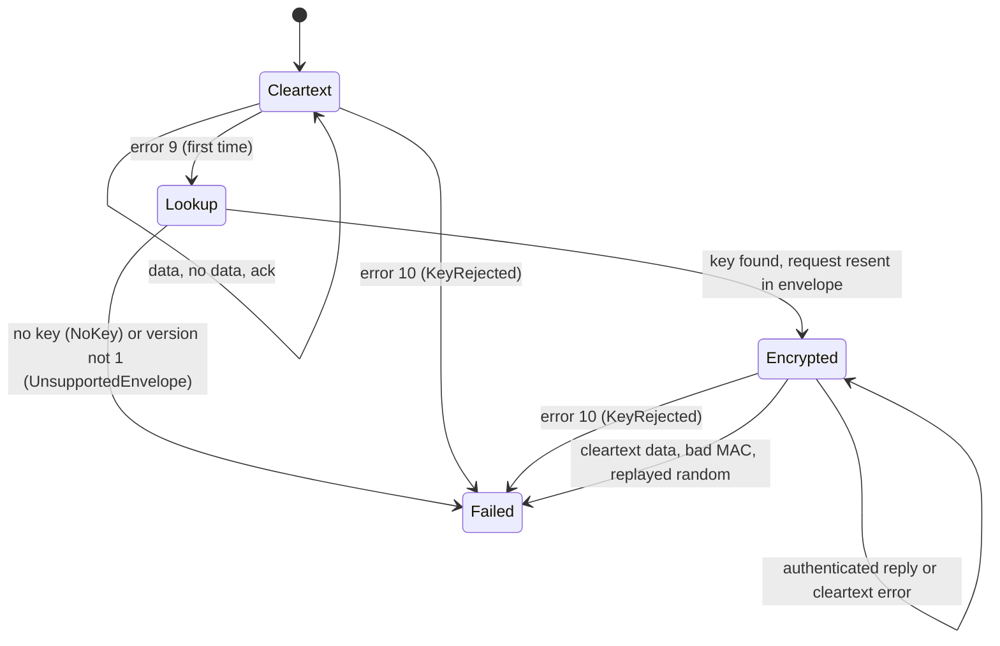

# The KMB protocol as implemented by `kmb` and `kmb-tokio`

This document describes the wire protocol exactly as the two crates in this
repository speak it: the frames they build, the replies they accept, and the
checks and limits they apply. It is written from the code and the tests in
this repository and from nothing else. Where the code picks a value that no
test pins against a real meter, the document says so.

It is not a complete description of the protocol that meters speak. Parts
the crates do not implement are listed in [Scope and status](#1-scope-and-status)
and are otherwise not described.

Contents:

1. [Scope and status](#1-scope-and-status)
2. [Conventions](#2-conventions)
3. [Frame](#3-frame)
4. [Request and reply model](#4-request-and-reply-model)
5. [Login PIN](#5-login-pin)
6. [Encrypted envelope](#6-encrypted-envelope)
7. [TLS](#7-tls)
8. [Command catalogue](#8-command-catalogue)
9. [Universal configuration](#9-universal-configuration)
10. [Archives](#10-archives)
11. [Timeouts, limits and retries](#11-timeouts-limits-and-retries)
12. [Errors](#12-errors)
13. [Known unknowns](#13-known-unknowns)

## 1. Scope and status

### Evidence levels

Every fact below carries one of three evidence levels:

| Level | Meaning |
| --- | --- |
| tested | a test in this repository pins the bytes or the behaviour |
| implemented | the code does it, but no test pins it |
| assumed | the code picks a value or a reading that no capture from a real meter confirms |

"Tested" means the crate agrees with its own test vectors. Those vectors were
constructed for the tests (frames, descriptions, records, the envelope vector,
the certificates). None of them is documented as a capture from a real meter,
so "tested" proves internal consistency and stable encoding, not
interoperability.

### Support matrix

| Area | Status | Evidence |
| --- | --- | --- |
| Long frame: address, 16-bit length, command, CRC-16 | supported | tested |
| Short frame with an 8-bit sum | not implemented | none |
| Identify reply, all ten accepted lengths | decoded | tested |
| Family classification from identify | decoded | tested |
| SMP meters with the universal configuration module | supported | tested |
| SMP meters without it ("classic" structures) | identify and clock read only | implemented |
| Other families (short-frame, other `props_type`) | identified, not supported | tested |
| Clock read, clock adjust (universal form) | supported | tested |
| Clock set, legacy and absolute adjust forms | request builders only | tested |
| Universal descriptions: read, values, write, commit | supported | tested |
| Saved configuration file (`kmbcfg`), two dialects | read and write | tested |
| Archives of universal meters | supported | tested |
| Archive formats of non-universal meters | not implemented | none |
| Reset, sub-constants, profiles, info, actual data, MTU probe | request builders only | tested |
| Other opcodes in `command::cmd` | constants only | none |
| PIN login | supported | tested |
| Encrypted envelope (AES-128-CBC, HMAC-SHA256, PSK) | supported | tested |
| TLS (feature `tls` of `kmb-tokio`) | supported | tested |
| Serial line setup (baud rate, parity, RS-485 turnaround) | not implemented | none |
| Modbus carried inside KMB | not implemented | none |

"Request builders only" means the crate builds the request bytes, but it
decodes no reply for it and `kmb-tokio` has no method for it; a caller can
send it with `Client::get`, `Client::set` or `Client::exchange`.

The crates are transport-neutral, but `kmb-tokio` only ships TCP
(`connect`) and TLS (`tls::connect_tls`). A serial gateway works through
`Client::new` with any `AsyncRead + AsyncWrite` stream; the crate does not
configure the line.

## 2. Conventions

### Byte order

All multi-byte integers on the wire are **big-endian** (most significant byte
first), including the frame length, the CRC, the PIN, times and every value
in the universal configuration. There are two exceptions, both inside
computations rather than wire fields:

- the PIN's user hash takes the first four MD5 digest bytes as a
  little-endian `u32` ([section 5](#5-login-pin));
- the archive record `Sum` adds the record body as little-endian 32-bit
  words ([section 10](#sum)).

Tables below repeat the byte order once per table. (tested)

### Time

A time on the wire (`KmbTime`) is an unsigned 64-bit big-endian count of
milliseconds since 2000-01-01 00:00:00. (tested)

| Value | Meaning in the crate | Evidence |
| --- | --- | --- |
| `0x0000_0000_0000_0000` | 2000-01-01 00:00:00.000 | tested |
| `0xFFFF_FFFF_FFFF_FFFF` | invalid time (`KmbTime::INVALID`) | tested |
| `36_525 * 86_400_000` | 2100-01-01; later archive record times are rejected | tested |
| `252_455_616_000_000` | `archive::LAST_RECORD_TIME`, 10000-01-01; unused by the client | tested |

The crate converts to and from Unix time by adding or subtracting
946 684 800 000 ms, that is, it treats the meter's time as **UTC**.
`KmbTime::from_unix_ms` maps any time before 2000 to the invalid value, and
`to_unix_ms` returns `None` for it. `KmbTime::add_ms` saturates and leaves the
invalid value alone. `kmb_tokio::now()` reads the system clock as UTC.
(tested) A meter may keep local time instead; see
[Known unknowns](#13-known-unknowns).

Example (tested): `KmbTime(842_961_600_000)` is 2026-09-17 12:00:00 UTC and
encodes as `00 00 00 C4 44 6D 3E 00`.

### Strings

| Where | Width | Encoding | Termination | Evidence |
| --- | --- | --- | --- | --- |
| identify `name` | 32, fixed | single-byte code page (CP1252) | first NUL; padded | tested |
| identify `archive_def` | 40, fixed | single-byte code page (CP1252) | first NUL; padded | tested |
| group, field, unit names | ≤ 30 | CP1252 | NUL, none at 30 bytes | tested |
| archive field names | ≤ 32 | CP1252 | NUL, none at 32 bytes | implemented |
| `String` values | `pb`, fixed | CP1252 | first NUL; padded | tested |
| envelope UID text | 29 | ASCII | none | tested |
| TLS common name | any | UTF-8 | none | tested |

Widths are in bytes.

Variable-length names are read byte by byte until a NUL or until the maximum
is reached; at the maximum no terminator is consumed. When writing, a name is
cut to the maximum and gets a NUL only if it is shorter. A `String` value is
cut or NUL-padded to exactly `pb` bytes, so a value of exactly `pb` bytes has
no NUL. (tested)

The CP1252 table maps 0x80 to 0x9F as Windows-1252 does; the five bytes
Windows-1252 leaves undefined (0x81, 0x8D, 0x8F, 0x90, 0x9D) map to the C1
control of the same number, and all other bytes map to the Unicode code point
of the same number. When encoding, a character outside the code page becomes
`?`. (implemented)

`decode::kmb_string` and `decode::encode_kmb_string` are helpers for the fixed
identify fields; `encode_kmb_string` always leaves at least one NUL. (tested)

### Floats

`F32` and `F64` are IEEE 754 binary32 and binary64, big-endian. The archive
group scale factor `k` is an `F32`. (tested)

## 3. Frame

### Layout

Byte order: big-endian.

| Offset | Size | Type | Field | Notes |
| --- | --- | --- | --- | --- |
| 0 | 1 | u8 | address | bus address of the meter; any value 0 to 255 |
| 1 | 2 | u16 | length | number of payload bytes, 0 to 65 535 |
| 3 | 1 | u8 | command | request opcode, or a reply code ([section 4](#4-request-and-reply-model)) |
| 4 | length | bytes | payload | |
| 4 + length | 2 | u16 | CRC | CRC-16 over bytes 0 to 3 + length, high byte first |

A frame is always `length + 6` bytes; the shortest frame is 6 bytes. There is
no start byte, no escaping and no padding: the length field alone delimits
frames in a byte stream. (tested)

`Frame::decode` refuses (tested):

| Condition | Error |
| --- | --- |
| fewer than 6 bytes | `FrameError::TooShort` |
| byte count is not `length + 6` | `FrameError::LengthMismatch` |
| stored CRC differs from computed | `FrameError::BadCrc` |

`Frame::encode` refuses a payload longer than 65 535 bytes
(`FrameError::PayloadTooLong`). (tested)

### CRC-16

| Parameter | Value |
| --- | --- |
| width | 16 bits |
| polynomial | 0x8005, processed bit-reflected as 0xA001 |
| initial value | 0xFFFF |
| input and output reflected | yes |
| final XOR | none |
| check value, `crc16(b"123456789")` | **0x4B37** |
| CRC of empty input | 0xFFFF |
| position and order on the wire | last two bytes of the frame, high byte first |

These are the CRC-16/MODBUS parameters, but the frame stores the result
high byte first. The check value was computed by running the crate and is
also pinned by the test `crc_check_value`. (tested)

### Worked example: identify request

`command::identify(1)` encodes as (tested):

```text
01 00 00 01 18 C0
|  |     |  +---- CRC-16 of "01 00 00 01" = 0x18C0, high byte first
|  |     +------- command 1 (identify)
|  +------------- length 0x0000: no payload
+---------------- address 1
```

Two more frames from the tests:

| Frame | Meaning |
| --- | --- |
| `01 00 01 10 00 C0 45` | acknowledgement of command 16 (payload `00`) |
| `01 00 01 F1 08 56 0C` | error reply to command 113 (0x71 \| 0x80), code 8 |

### Reassembly and limits

`FrameDecoder` reassembles frames from arbitrary read chunks (tested):

1. It waits for the 4 header bytes.
2. If the declared length exceeds its limit, it returns
   `FrameError::OverLimit` and discards its whole buffer. The limit is 65 535
   (`frame::MAX_PAYLOAD_LEN`) by default and can be lowered with
   `FrameDecoder::with_max_payload`.
3. It waits until `length + 6` bytes are buffered.
4. It decodes the frame. On success it removes exactly that frame and keeps
   any following bytes for the next frame. On any error it discards the whole
   buffer; it does not search for the next frame boundary.

## 4. Request and reply model

The client sends one request frame and reads one or more reply frames. A
reply carries the same address and, for a normal reply, the same command
byte as the request.

### Kinds of reply

`Frame::reply` reads a reply frame as one of (tested):

| Reply | How it is recognised | `Reply` value |
| --- | --- | --- |
| error | command byte has bit 7 set | `Error { command, code, data }` |
| no data | payload is exactly `55 6E` (ASCII `Un`) | `NoData` |
| data | anything else with a non-empty payload | `Data(payload)` |
| empty | empty payload | refused with `EmptyReply` |

An **acknowledgement** of a set request is a normal reply whose payload is
the single byte `00` (`Frame::is_ack`). `Client::set` accepts nothing else;
any other payload is `Error::NotAcknowledged`. (tested)

### Errors

The protocol rule is: for a request with a command below 128, an error reply
carries the command `request | 0x80` and a payload of one error code byte
followed by optional data. `Frame::reply_to(request)` applies exactly this
rule: the reply is an error only when the request is below 128 and the reply
command is `request | 0x80`; `command` is then the request and `code` the
first payload byte. `Frame::reply()`, which has no request to go by, reads
any command of 0x80 or above as an error. (tested)

| Code | `ErrorCode` | Meaning | Client action |
| --- | --- | --- | --- |
| 8 | `NoPermission` | the login does not permit it | `Error::Device` |
| 9 | `EncryptionRequired` | envelope required; data is the handshake | starts the envelope |
| 10 | `KeyInvalid` | the meter could not open the envelope | `Error::KeyRejected` |
| other | `Other(n)` | not interpreted | `Error::Device` |

Two opcodes in `command::cmd` are 128 or above (145, 146). A reply to them
is never an error under `reply_to`; `kmb-tokio` uses `reply_to` throughout,
so their replies are data. (tested)

### "No data"

A reply whose payload is exactly the two bytes `Un` is "no data"
(`Reply::NoData`, `Error::NoData` in the client). A payload that merely starts
with `Un` is data. (tested) What a meter means by it beyond "nothing to
return" is not known; see [Known unknowns](#13-known-unknowns).

### Checks made by `kmb-tokio`

For every reply frame of an exchange, after opening the envelope if one is
active (tested):

| Check | On failure |
| --- | --- |
| reply address equals request address | `Error::WrongAddress(address)` |
| reply command is the request command, or it \| 0x80 | `Error::Decode` ("command differs") |

With the envelope active, both checks apply to the inner frames. After a
failed check the client clears its reassembly buffer. Before sending each
request the client discards whatever is already waiting on the stream (it
reads without waiting, at most 64 times) and clears its reassembly buffer,
so a reply that arrives after a timeout is not taken for the next answer.
(tested)

### Multi-frame replies

`Client::exchange(frame, n)` reads `n` reply frames for one request (one when
the envelope is active). Only archive reads ask for more than one frame
([section 10](#10-archives)). A timeout on the first frame is
`Error::Timeout`; a timeout on a later frame ends the exchange with the
frames received so far, and the archive reader asks again from the next
slot. Any other error on any frame fails the whole exchange. (tested)

## 5. Login PIN

### Derivation

| Step | Computation | Evidence |
| --- | --- | --- |
| user hash | first 4 bytes of MD5(user ‖ password), read as a little-endian `u32` | tested |
| wire PIN | user hash + serial number (`Identify::device_no`), wrapping at 2³² | tested |

User and password are taken as their UTF-8 bytes, concatenated with no
separator. Test vector: user `admin`, password `1234` gives the user hash
0x78CD3CC9; with serial 12345 the wire PIN is 0x78CD6D02. (tested)

In `kmb-tokio` (tested):

- before a successful `identify`, the PIN is 0;
- without `set_credentials`, the user hash is 0, so the PIN equals the serial
  number.

### Preamble shapes

The PIN is sent in one of three preambles, all big-endian:

| Shape | Bytes 0 to 3 | Bytes 4 to 7 | Built by | Evidence |
| --- | --- | --- | --- | --- |
| A | PIN | `00 00 00 00` | `pin::block_a`, `command::set` | tested |
| B | `00 00 00 00` | PIN | `pin::block_b`, `command::set_shape_b` | tested |
| universal | PIN | `00 00 00` + one byte | `uni::get`, `uni::set` | tested |

In the universal shape byte 7 is the data set's `cm_typ` in a get request
and 0 in a set request ([section 9](#9-universal-configuration)). With
`cm_typ` 0 it is identical to shape A.

### Requests that carry the PIN

| Request | Shape |
| --- | --- |
| reset (0), set clock (16), universal adjust (18), set sub-constants (33), clear (56) | A |
| generic `command::set` | A |
| generic `command::set_shape_b` (the tests use it for 51) | B |
| every universal get and set (112 to 125) | universal |

Identify, clock read, archive reads, record by time, info, actual data and the
other `command` builders carry no PIN. `command::set_s_profile_day` puts 8 zero
bytes where a preamble would be. (tested)

The `kmb-tokio` methods that send the PIN are `adjust_clock`,
`read_description`, `read_values`, `read_archive_description`,
`write_description` and `write_group`. (implemented)

### Weakness

The PIN has no salt, challenge or session value, and the serial number is in
the cleartext identify reply. Anyone who sees one PIN on a cleartext link can
subtract the serial, compute the PIN for every other meter with the same user
and password, and guess the password offline against 32 bits of an unsalted
MD5. Protect the link with the envelope or TLS, and give every meter its own
credentials.

### Client policy switches

| Switch | Effect | Evidence |
| --- | --- | --- |
| `set_refuse_cleartext_pin(true)` | refuse to send the PIN in cleartext, see below | tested |
| `set_secure_transport(true)` | mark the transport as protecting the link | tested |
| `set_require_encryption(true)` | refuse any cleartext reply other than an error | tested |

- With `set_refuse_cleartext_pin(true)`, a method that sends the PIN fails
  with `Error::Precondition` before sending if credentials are set and
  neither the envelope nor a secure transport is active.
- `tls::connect_tls` calls `set_secure_transport(true)` itself.
- With `set_require_encryption(true)`, a cleartext data reply or
  acknowledgement fails with `Error::Envelope(NotEnvelope)`. A meter that
  does not ask for the envelope is therefore refused at the first identify,
  before any PIN-carrying request; the PIN stays 0 because no identity was
  stored.

The refusal checks only the client methods listed above; frames a caller
builds and sends with `get`, `set` or `exchange` are not inspected. Without
credentials nothing is refused, since no secret is involved. (implemented)

## 6. Encrypted envelope

A meter that requires encryption answers a cleartext request with error 9.
From then on every request and reply is wrapped in an envelope frame with
command 111 (`envelope::ENVELOPE_COMMAND`).

### Handshake

The error 9 reply's data (the payload after the code byte) is (tested):

| Offset | Size | Type | Field | Notes |
| --- | --- | --- | --- | --- |
| 0 | 1 | u8 | version | the crate supports 1 (`envelope::VERSION`) |
| 1 | 12 | bytes | uid | the meter's unique ID |
| 13 | rest | bytes | ignored | |

Fewer than 13 bytes is `EnvelopeError::HandshakeTooShort`; another version is
`Error::UnsupportedEnvelope`. (tested)

The UID's text form is the 12 bytes as uppercase hex, in six groups of two
bytes joined by `-`: bytes `00 01 … 0B` give `0001-0203-0405-0607-0809-0A0B`
(`envelope::uid_string`). (tested)

Test vector (synthetic), error 9 to identify:
`01 00 0E 81 09 01 00 01 02 03 04 05 06 07 08 09 0A 0B 02 2B`.

### PSK

The pre-shared key is 32 bytes. The crate takes it from:

| Source | Rule | Evidence |
| --- | --- | --- |
| `Psk::from_base64` | standard Base64, whitespace trimmed, exactly 32 bytes decoded | tested |
| `Psk::from_password(password, salt)` | PBKDF2-HMAC-SHA1, 100 000 rounds, 32 bytes out | tested |
| `Client::set_keys` | a lookup from UID text to PSK, called at the handshake | tested |

Password and salt are taken as their UTF-8 bytes.

Test vector computed by the crate: password `password` with salt
`0001-0203-0405-0607-0809-0A0B` gives
`0849e9a149961dc597fd86ba965efc6dbb1960523e989a340fea7a92af5c87cb`. Which
salt a meter's key was made with is up to whoever provisioned it; the
crate does not choose one. (assumed)

### Envelope payload

Byte order: big-endian (no multi-byte integers).

| Offset | Size | Type | Field | Notes |
| --- | --- | --- | --- | --- |
| 0 | 1 | u8 | version | 1 |
| 1 | 32 | bytes | random | fresh per envelope, from the OS random source |
| 33 | 16·n | bytes | ciphertext | n ≥ 1 |
| 33 + 16·n | 32 | bytes | MAC | HMAC-SHA256 tag |

The outer frame has the inner frame's address and command 111. The plaintext
is the **whole encoded inner frame**: address, length, command, payload and
CRC. (tested)

### Keys and MAC

| Item | Derivation |
| --- | --- |
| message key K | SHA-256(PSK ‖ random), 32 bytes |
| AES key | K bytes 0 to 15 (AES-128) |
| IV | random bytes 0 to 15 |
| cipher | AES-128-CBC |
| padding | PKCS#7: 1 to 16 bytes, always present |
| MAC key | K (the code passes K followed by 32 zero bytes, which HMAC-SHA256 treats identically) |
| MAC input | version ‖ random ‖ ciphertext |

The ciphertext length is `((inner_payload_len + 6) / 16 + 1) · 16`, so an
empty inner payload gives 16 bytes and an 81-byte envelope payload. (tested)

### Unwrapping

`envelope::unwrap` checks, in this order (tested):

| Check | Error |
| --- | --- |
| command is 111 | `EnvelopeError::NotEnvelope` |
| payload at least 81 bytes and ciphertext a multiple of 16 | `EnvelopeError::BadLength` |
| version is 1 | `EnvelopeError::Version` |
| MAC matches (constant-time compare) | `EnvelopeError::BadMac` |
| PKCS#7 padding valid after decryption | `EnvelopeError::BadPadding` |
| plaintext is a valid frame (length and CRC) | `EnvelopeError::Inner` |

### Replay window

The envelope has no sequence number. `kmb-tokio` remembers the randoms of the
last 1024 envelopes (`REPLAY_WINDOW`) it sent or accepted in this session and
refuses a reply whose random is among them (`Error::Decode`, "random repeats
an earlier envelope"). A reply recorded in an earlier session cannot be
detected. The command echo check ([section 4](#checks-made-by-kmb-tokio))
applies to the inner frame, so a recorded acknowledgement of a different
command is refused as well. (tested)

### Cleartext policy

Once the envelope is active (tested):

- a reply with command 111 is unwrapped and checked as above;
- a cleartext error reply (command with bit 7 set) is still accepted and
  read as a device error, so the meter can refuse a request;
- any other cleartext reply fails with `Error::Envelope(NotEnvelope)`;
- each request reads exactly one reply frame, and archive reads ask for one
  frame per request.

Without the envelope, a reply with command 111 fails with
`Error::Envelope(NotEnvelope)`. (implemented)

### State diagram



The request that met error 9 is resent once, wrapped (tested). A second
error 9 for the same request is returned as `Error::Device`, and the session
stays encrypted for the life of the `Client` (implemented).

### Test vector

The repository's envelope vector is synthetic: PSK bytes `00 01 … 1F`,
random `20 21 … 3F`, inner frame `01 00 00 01 18 C0` (identify). The crate
encodes it as this 87-byte frame (tested, test `e9_wrap`):

```text
01 00 51 6F 01 20 21 22 23 24 25 26 27 28 29 2A 2B 2C 2D 2E 2F 30 31 32
33 34 35 36 37 38 39 3A 3B 3C 3D 3E 3F A6 AC 72 5A 95 8E 26 91 3C 32 B0
F5 38 BC C9 DA 70 77 CF DD EA C0 29 47 EB B7 10 99 1F D5 2E 2B C7 10 E0
37 7E E6 26 13 D4 92 94 B6 09 E7 04 9C 51 17
```

## 7. TLS

With the feature `tls`, `kmb_tokio::tls::connect_tls(addr, address, trust)`
opens TCP, runs a TLS handshake with rustls (ring provider, its safe default
protocol versions, no client certificate) and then speaks plain KMB frames
inside. The default port is 7101 (`TLS_PORT`); the address argument is used
as given. (implemented)

| Item | Value | Evidence |
| --- | --- | --- |
| SNI and server name | `default` (`tls::SERVER_NAME`) | implemented |
| host name check | none; the server name is not compared with the certificate | tested |
| client marks transport secure | yes | implemented |
| archive reads | one reply frame per request | implemented |

### Trust modes

`tls::Trust` holds what the meter's certificate is checked against. No root
key or pin is built in.

| Mode | Accepts | Evidence |
| --- | --- | --- |
| `Root(x, y)` | a chain to the given P-256 public key | tested |
| `Pinned(pins)` | an end-entity certificate whose SHA-256 of the DER is in `pins` | tested |
| `RootOrPinned(x, y, pins)` | a pinned certificate, else a chain to the root | tested |

The root is the uncompressed P-256 point: `x` and `y` are 32 bytes each;
`tls::parse_p256_point` reads it from hex as `04` ‖ x ‖ y, with `:` and spaces
allowed. (tested)

### What is checked

For a pinned certificate: only the fingerprint. Validity dates, key usage and
the chain are not checked. (tested)

For the root path, `rustls-webpki` verifies the chain from the end-entity
certificate through the intermediates the meter sends to a trust anchor made
of the given key, with these settings (implemented):

| Check | Setting |
| --- | --- |
| signatures along the chain | all algorithms `webpki` supports |
| anchor name | taken from the issuer of the topmost certificate sent |
| validity period | checked against the current time |
| extended key usage | serverAuth if the extension is present |
| revocation | not checked |
| host name | not checked |

Because the anchor is a key, any certificate of the same CA passes. To bind
the connection to one meter, use pins, or
`tls::connect_tls_with(addr, address, Verifier::new(trust).expecting_common_name(cn))`,
which also requires the end-entity certificate's subject common name
(UTF8String, PrintableString or IA5String) to equal `cn`. The common name is
checked on the root path only; a pinned certificate is accepted whatever its
name. (tested)

The handshake signatures (TLS 1.2 and 1.3) are verified with the ring
provider's algorithms. (implemented)

The test certificates are generated at test time; no meter certificate is in
the repository.

## 8. Command catalogue

Status: **client** means a `kmb-tokio` method sends it; **builder** means a
`kmb::command` (or `uni`, `archive`) function builds it; **constant** means
only the opcode is defined.

| Code | Hex | Name | Request payload | PIN | Reply | Crate API | Status |
| --- | --- | --- | --- | --- | --- | --- | --- |
| 0 | 0x00 | RESET | A, code u32 | A | ack | `command::reset` | builder |
| 1 | 0x01 | IDENTIFY | empty | no | identify | `identify` | client |
| 16 | 0x10 | SET_RTC | A, `00 01`, time | A | ack | `command::set_rtc` | builder |
| 17 | 0x11 | GET_RTC | `00 01` | no | clock | `read_clock` | client |
| 18 | 0x12 | ADJUST_TIME | three forms | universal form | ack | `adjust_clock` | client |
| 20 | 0x14 | GET_STATUS | empty | no | not decoded | `command::get` | constant |
| 22 | 0x16 | GET_RECORD | see section 10 | no | records | `download` … | client |
| 23 | 0x17 | RECORD_BY_TIME | archive u8, time | no | slot, time | `record_at_time` | client |
| 26 | 0x1A | SET_CONSTANTS | | | | | constant |
| 27 | 0x1B | GET_CONSTANTS | | | | | constant |
| 31 | 0x1F | GET_NOTEBOOK | | | | | constant |
| 32 | 0x20 | SET_NOTEBOOK | | | | | constant |
| 33 | 0x21 | SET_SUB_CONSTANTS | A, id u8, data | A | ack | `set_sub_constants` | builder |
| 34 | 0x22 | GET_SUB_CONSTANTS | id u8 | no | not decoded | `get_sub_constants` | builder |
| 35 | 0x23 | SET_ARC_CONFIG | | | | | constant |
| 38 | 0x26 | GET_INSTALL_CONFIG | | | | | constant |
| 39 | 0x27 | SET_INSTALL_CONFIG | | | | | constant |
| 40 | 0x28 | GET_MODEM_INIT | | | | | constant |
| 41 | 0x29 | SET_MODEM_INIT | | | | | constant |
| 48 | 0x30 | GET_OUTPUT_CONFIG | | | | | constant |
| 49 | 0x31 | SET_OUTPUT_CONFIG | | | | | constant |
| 50 | 0x32 | GET_ELMER_TARIFF | | | | | constant |
| 51 | 0x33 | SET_ELMER_TARIFF | | | | | constant |
| 52 | 0x34 | GET_ELMER | `00` | no | not decoded | `command::get_elmer` | builder |
| 54 | 0x36 | GET_PROFILE_STATUS | | | | | constant |
| 55 | 0x37 | SET_S_PROFILE_TIME | 8 × `00`, day, month | no | ack | `set_s_profile_day` | builder |
| 56 | 0x38 | CLEAR_M_PROFILE | A | A | ack | `command::clear_m_profile` | builder |
| 58 | 0x3A | GET_ALL_ACT_DATA | mask u32 | no | not decoded | `command::act_data` | builder |
| 70 | 0x46 | INFO | block u32 | no | not decoded | `command::info` | builder |
| 71 | 0x47 | GET_DISPLAY | | | | | constant |
| 72 | 0x48 | SET_DISPLAY | | | | | constant |
| 78 | 0x4E | GET_CONFIG | | | | | constant |
| 79 | 0x4F | SET_CONFIG | | | | | constant |
| 82 | 0x52 | GET_PQ_SETTINGS | | | | | constant |
| 83 | 0x53 | SET_PQ_SETTINGS | | | | | constant |
| 98 | 0x62 | SET_MODULES | | | | | constant |
| 99 | 0x63 | GET_ADDITIONAL_CONFIG | | | | | constant |
| 100 | 0x64 | SET_ADDITIONAL_CONFIG | | | | | constant |
| 111 | 0x6F | ENCRYPTED | envelope | inner | envelope | automatic | client |
| 112 | 0x70 | get Config | universal get | universal | page | `read_description` | client |
| 113 | 0x71 | set Config | universal set | universal | ack | `write_description` | client |
| 114 | 0x72 | get ActData | universal get | universal | page | `read_description` | client |
| 115 | 0x73 | set ActData | universal set | universal | ack | `write_description` | client |
| 116 | 0x74 | get Archive | universal get | universal | page | `read_archive_desc…` | client |
| 117 | 0x75 | set Archive | universal set | universal | ack | `uni::clear_archives` | builder |
| 118 | 0x76 | get Status | universal get | universal | page | `read_description` | client |
| 119 | 0x77 | set Status | universal set | universal | ack | `write_description` | client |
| 120 | 0x78 | get Avg/Max/Min | universal get | universal | page | `read_description` | client |
| 121 | 0x79 | set Avg/Max/Min | universal set | universal | ack | `write_description` | client |
| 122 | 0x7A | get Edata | universal get | universal | page | `read_description` | client |
| 123 | 0x7B | set Edata | universal set | universal | ack | `write_description` | client |
| 124 | 0x7C | get Cal | universal get | universal | page | `read_description` | client |
| 125 | 0x7D | set Cal | universal set | universal | ack | `write_description` | client |
| 145 | 0x91 | BROADCAST | | | | | constant |
| 146 | 0x92 | MTU_PROBE | n bytes of `01` | no | not decoded | `command::mtu_probe` | builder |

"A" is the 8-byte shape A preamble of [section 5](#preamble-shapes); "time"
is an 8-byte `KmbTime`; all integers are big-endian. Every builder's bytes
are pinned by a test. For the constant-only opcodes the crate does not know
the payload; `command::get(address, cmd)` sends an empty payload,
`command::set` prepends shape A and `command::set_shape_b` shape B. The tests
use shape A for SET_NOTEBOOK (64 data bytes) and shape B for
SET_ELMER_TARIFF, but these only pin the builders, not what a meter expects.
(assumed)

Other test frames: GET_STATUS to address 1 is `01 00 00 14 D7 01`, and
BROADCAST with payload `01` to address 250 is `FA 00 01 91 01 84 01`.
`command::MTU_PROBE_SIZES` lists 10, 6800, 1300 and 500; the client does not
probe. (tested)

### Identify

Request: command 1, empty payload. Reply payload, byte order big-endian
(tested):

| Offset | Size | Type | Field | Notes |
| --- | --- | --- | --- | --- |
| 0 | 2 or 4 | u16 or u32 | `device_no` | serial number; 4 bytes for lengths 17, 28, 48, 88 |
| d | 2 | u16 | `device_type` | 0 is read as 0x4000 for the family |
| d+2 | 2 | u16 | `props_type` | 0 is read as 48 for the family |
| d+4 | 2 | u16 | `software_version` | bits 0 to 13 build, bits 14 to 15 series |
| d+6 | 2 | u16 | `hardware_version` | |
| d+8 | 2 | u16 | `software_modules` | bit 0x0080: universal configuration |
| d+10 | 1 | u8 | `device_addr` | |
| d+11 | 1 | u8 | `bootloader_version` | 0xFF is read as 0 |
| d+12 | | | tail | depends on the length, below |

`d` is 2 or 4, the width of `device_no`. The tail by payload length:

| Length | `device_no` | Tail |
| --- | --- | --- |
| 14 | u16 | none |
| 15 | u16 | 1 byte, ignored |
| 16 | u16 | `sub_device_type[0]` u16 |
| 17 | u32 | 1 byte, ignored |
| 26 | u16 | `sub_device_type[0..6]`, 6 × u16 |
| 28 | u32 | `sub_device_type[0..6]`, 6 × u16 |
| 48 | u32 | `name`, 32 bytes |
| 56 | u16 | `sub_device_type[0]` u16, `archive_def` 40 bytes |
| 66 | u16 | `sub_device_type[0..6]`, `archive_def` 40 bytes |
| 88 | u32 | `name` 32 bytes, `archive_def` 40 bytes |

Any other length is `DecodeError::Length`. Unset `sub_device_type` entries
are 0. (tested)

Derived values (tested):

| Value | Rule |
| --- | --- |
| `build()` | `software_version & 0x3FFF` |
| `firmware_version()` | `0.9.0.<build>` if bits 14 to 15 are 0, else `1.0.0.<build>` |
| `bootloader()` | `<v / 10>.<v % 10>` |
| `is_universal()` | `software_modules & 0x0080 != 0` |
| `takes_absolute_adjust_time()` | the whole `software_version` ≥ 19166 (0x4ADE) |

Family, from `props_type` (0 read as 48) and `device_type` (0 read as
0x4000), first match wins (tested):

| Condition | `Family` |
| --- | --- |
| `props_type` ≠ 48 | `OtherProps(props_type)` |
| `device_type & 0xF000` = 0x9000 | `SmpG3` |
| `& 0xF000` = 0x7000 or 0x8000, or `& 0xFF00` = 0xB100 | `SmpOlder` |
| `& 0xF000` = 0x3000, 0x4000 or 0x6000 | `SmpClassic` |
| `& 0xF000` = 0x0000, 0x1000 or 0xA000 | `ShortFrame` |
| anything else | decode fails: "unknown device type" |

Only the universal module bit decides what the client can do with a meter;
the family is informational. `adjust_clock` refuses a meter without the
bit; the description reads do not check it. (implemented)

### Clock

Read (tested): request command 17, payload `00 01`. Reply payload:

| Offset | Size | Type | Field | Notes |
| --- | --- | --- | --- | --- |
| 0 | 2 | u16 | tag | must be 1 |
| 2 | 8 | u64 | time | `KmbTime` |
| 10 | 8 | u64 | extra | present if the payload is 18 bytes or longer; meaning unknown |

Set (tested): command 16, shape A, then `00 01` and the time: 18 bytes.
Example: `01 00 12 10 78 CD 6D 02 00 00 00 00 00 01 00 00 00 C4 44 6D 3E 00 D3 AF`.

Adjust, command 18, three forms (tested):

| Builder | Payload | Bytes |
| --- | --- | --- |
| `adjust_time_legacy` | seconds into the hour u16, `FF` | 3 |
| `adjust_time_absolute` | time, `FF` | 9 |
| `adjust_time_universal` | shape A, `00 00`, time | 18 |

`Identify::takes_absolute_adjust_time` tells the legacy and absolute forms
apart by the firmware threshold above. `Client::adjust_clock` sends only the
universal form, to universal meters: it reads the clock, then sends
`now() + half the read's round trip` and expects an acknowledgement.
(tested)

`command::AdjustResult` reads an adjust result byte (tested as a mapping; the
client does not use it, and a result other than `00` fails `adjust_clock`
with `Error::NotAcknowledged`):

| Byte | `AdjustResult` |
| --- | --- |
| 0x00 | `Full` |
| 0xC0 | `Partial` |
| 0x90 | `ShortRecordLength` |
| 0xA0 | `BadSyncConfig` |
| other | `Error(byte)` |

### Reset

Command 0, shape A, then the reset code as u32 big-endian: 12 bytes. Example
for PIN 0x01020304 and `ADMIN`: `01 02 03 04 00 00 00 00 63 A2 79 3B`.
(tested) Codes in `command::reset` (implemented; none is tested against a
meter):

| Code | Name | Code | Name |
| --- | --- | --- | --- |
| 0x0000_0000 | `MAIN` | 0x0000_0100 | `ACT_ELMER` |
| 0x0000_0001 | `S_PROFILE` | 0x0000_0200 | `PAVG_MAX_CMLM` |
| 0x0000_0002 | `M_PROFILE` | 0x0000_0300 | `PAVG_MAX_TOT` |
| 0x0000_0003 | `LOG` | 0x0000_0301 | `UIAVG_MAX` |
| 0x0000_0004 | `PQ_MAIN` | 0x0000_0302 | `PQAVG_MAX` |
| 0x0000_0005 | `PQ_EVENTS` | 0x0000_0303 | `RCM_MAX` |
| 0x0000_0006 | `ELMER` | 0x0000_0400 | `GRAPHS` |
| 0x0000_0008 | `PQ_OSCILLOGRAM` | 0x0000_0500 | `MAX_DB1` |
| 0x0000_0009 | `PQ_EVENT_TREND_ARCHIVE` | 0x0000_0600 | `MAX_DB2` |
| 0x0000_000A | `HDO_ARCHIVE` | 0x7365_72FF | `DEVICE` |
| 0x0000_000B | `VLNY_ARCHIVE` | 0x63A2_793B | `ADMIN` |
| 0x0000_000C | `MM_ARCHIVE` | 0x2C22_649B | `SNTP_SYNC` |
| 0x0000_000D | `TEN_MINS` | 0x256A_A120 | `SUSPEND_RECORD` |
| 0x0000_000E | `PQ_TABLE` | 0x256A_A121 | `RESUME_RECORD` |
| 0x0000_000F | `HISTOGRAM` | 0xAAAA_AAA1 | `COMM_STARTGO` |
| | | 0xAAAA_AAA2 | `COMM_STARTPQOSC` |
| | | 0xAAAA_AAA3 | `COMM_STARTPQTREND` |

### Archive read, probe, by parts, record by time

These are described with the archives in [section 10](#archive-requests).

### Actual data and info

Actual data (tested): command 58, payload a u32 mask, big-endian;
`command::ACT_DATA_ALL` is 0xFFFF_FFFF. The reply is not decoded; universal
meters' live values are read through the ActData data set instead.

Info (tested): command 70, payload a u32 block number, big-endian. The reply
is not decoded.

| Block | Name | Block | Name |
| --- | --- | --- | --- |
| 1 | `BLOCKS` | 5 | `ECC_STATE` |
| 2 | `TIMES` | 6 | `COMMUNICATION` |
| 3 | `TOU` | 7 | `WDG` |
| 4 | `TIMES_MAX` | 8 | `ETH` |
| 1000 + n | `raw_archive(n)` | | |

Example: `info(1, raw_archive(3))` has the payload `00 00 03 EB`.

## 9. Universal configuration

A universal meter describes its own data. Each data set is read in three
phases (groups, fields, values) and can be written back field by field.

### Data sets

| `DataSet` | Get | Set | `cm_typ` | Evidence |
| --- | --- | --- | --- | --- |
| `Config` | 112 | 113 | 0 | tested |
| `ActData` | 114 | 115 | 0 | tested |
| `Archive` | 116 | 117 | 0 | tested |
| `Status` | 118 | 119 | 0 | tested |
| `AvgData` | 120 | 121 | 0 | implemented |
| `MaxData` | 120 | 121 | 1 | tested |
| `MinData` | 120 | 121 | 2 | implemented |
| `MaxDataT` | 120 | 121 | 3 | implemented |
| `MinDataT` | 120 | 121 | 4 | tested |
| `Edata` | 122 | 123 | 0 | tested |
| `Cal` | 124 | 125 | 0 | tested |

The Archive data set carries the archive descriptions; its values phase is
not read ([section 10](#10-archives)).

### Phases (`rezim`)

| `rezim` | Name | Direction | Data |
| --- | --- | --- | --- |
| 0 | `GROUPS` | get | group list |
| 1 | `FIELDS` | get | field list |
| 2 | `VALUES` | get | values |
| 3 | `WRITE` | set | values |
| 4 | `COMMIT` | set | changed group indexes, `FF` |
| 5 | `CHANGE_COUNTER` | get (assumed) | one byte; decoder `uni::change_counter` only |

### Get request

`uni::get(address, pin, set, rezim, start, count_r)`, payload 17 bytes,
big-endian (tested):

| Offset | Size | Type | Field | Notes |
| --- | --- | --- | --- | --- |
| 0 | 4 | u32 | PIN | |
| 4 | 3 | bytes | zero | |
| 7 | 1 | u8 | `cm_typ` | of the data set |
| 8 | 1 | u8 | `rezim` | |
| 9 | 2 | u16 | start | first entry of the page |
| 11 | 2 | u16 | zero | |
| 13 | 2 | u16 | zero | |
| 15 | 2 | u16 | `count_r` | the client always sends 65 000 (`COUNT_R_ALL`) |

Example, Config fields with PIN 0x3039:
`00 00 30 39 00 00 00 00 01 00 00 00 00 00 00 FD E8`.

### Set request

`uni::set(address, pin, command, rezim, start, count, data)`, payload
17 bytes plus data, big-endian (tested):

| Offset | Size | Type | Field | Notes |
| --- | --- | --- | --- | --- |
| 0 | 4 | u32 | PIN | |
| 4 | 4 | bytes | zero | `cm_typ` is not sent in a set |
| 8 | 1 | u8 | `rezim` | 3 or 4 |
| 9 | 2 | u16 | start | first field index of the chunk |
| 11 | 2 | u16 | zero | |
| 13 | 2 | u16 | count | number of fields in the chunk |
| 15 | 2 | u16 | 65 000 | |
| 17 | rest | bytes | data | |

Commit (tested): `uni::commit` sends command 113 with `rezim` 4, start 0,
count 0 and data = the changed group indexes followed by `FF`. Example for
group 2: `… 04 00 00 00 00 00 00 FD E8 02 FF`. `uni::clear_archives` sends the
same shape with command 117 and archive group indexes (builder only).

### Reply pages

Every get reply starts with a cursor, big-endian (tested):

| Offset | Size | Type | Field |
| --- | --- | --- | --- |
| 0 | 2 | u16 | start |
| 2 | 2 | u16 | count |
| 4 | 2 | u16 | total |
| 6 | rest | bytes | entries |

Paging rules (tested):

| Rule | Result |
| --- | --- |
| start + count < total | more: the next page starts at start + count |
| start + count = total | done |
| start + count > total, or overflows | error |
| start = 0 | the list collected so far is dropped and restarts |
| start ≠ number of entries collected | error, "page does not continue the list" |
| done, but entries collected ≠ total | error, except a group list with total 0 |
| next start not greater than this start | `kmb-tokio` error, "does not advance" |

Entries with an empty name are dropped after parsing, and the dropped
entries do not count towards `total`. For values, start + count must not
exceed the number of fields known. The client reads each phase from start 0
and retries a page up to 4 times (`PAGE_ATTEMPTS`) on a timeout, a bad frame
or "no data". (tested)

### Group entry (rezim 0)

Repeated until a byte `FF` where an index would be (tested):

| Offset | Size | Type | Field | Notes |
| --- | --- | --- | --- | --- |
| 0 | 1 | u8 | `idx` | group index, not `FF` |
| 1 | 1 | u8 | `idxs` | |
| 2 | ≤ 30 | text | name | CP1252, NUL-terminated unless 30 bytes |

### Field entry (rezim 1)

Exactly `count` entries, big-endian (tested):

| Offset | Size | Type | Field | Notes |
| --- | --- | --- | --- | --- |
| 0 | ≤ 30 | text | name | NUL-terminated unless 30 bytes; a `\|` starts a long name |
| n | 1 | u8 | `ic` | index of the field's group |
| n+1 | 1 | u8 | type | value type code, below |
| n+2 | 2 | u16 | `pb` | element count or byte length |
| n+4 | 1 | u8 | `store` | the crate keeps the low 4 bits; > 0: kept in a saved file |

### Values (rezim 2)

The values of fields `start` to `start + count - 1`, in field order, each
encoded by the field's type and `pb`, with nothing between them. (tested)

### Archive group entry (116, rezim 0)

Repeated until `FF`, big-endian (tested):

| Offset | Size | Type | Field | Notes |
| --- | --- | --- | --- | --- |
| 0 | 1 | u8 | `idx` | not `FF` |
| 1 | 1 | u8 | `idxs` | sub-group; 0 for an archive |
| 2 | 1 | u8 | `idxss` | sub-sub-group; 0 for an archive |
| 3 | 2 | u16 | `typ` | not interpreted |
| 5 | 4 | f32 | `k` | scale factor |
| 9 | ≤ 30 | text | unit | |
| m | ≤ 30 | text | name | |

### Archive field entry (116, rezim 1)

Exactly `count` entries, big-endian (tested):

| Offset | Size | Type | Field | Notes |
| --- | --- | --- | --- | --- |
| 0 | ≤ 32 | text | name | NUL-terminated unless 32 bytes |
| n | 1 | u8 | `ic` | archive group index |
| n+1 | 1 | u8 | `ics` | sub-group index |
| n+2 | 1 | u8 | `icss` | sub-sub-group index |
| n+3 | 1 | u8 | `info1` | |
| n+4 | 1 | u8 | `info2` | |
| n+5 | 1 | u8 | type | value type code |
| n+6 | 2 | u16 | `pb` | |
| n+8 | 1 | u8 | `zapis` | 0: not stored in the record |
| n+9 | 1 | u8 | m | only if `info2` is 200 or 20 to 29 |
| n+10 | m | bytes | `zapis2` | only with m; not interpreted |

### Value types

Byte order: big-endian. Width is in bytes; `pb` is the field's `pb`.
(implemented for all; widths or round trips of most types are tested)

| Code | Name | Width | Encoding |
| --- | --- | --- | --- |
| 0 | `U8` | 1 | unsigned |
| 1 | `U16` | 2 | unsigned |
| 2 | `U32` | 4 | unsigned |
| 3 | `U64` | 8 | unsigned |
| 4 | `F32` | 4 | IEEE 754 binary32 |
| 5 | `F64` | 8 | IEEE 754 binary64 |
| 6 | `S8` | 1 | two's complement |
| 7 | `S16` | 2 | two's complement |
| 8 | `S32` | 4 | two's complement |
| 9 | `S64` | 8 | two's complement |
| 10 | `U8Array` | pb | pb × u8 |
| 11 | `U16Array` | 2·pb | pb × u16 |
| 12 | `U32Array` | 4·pb | pb × u32 |
| 13 | `F32Array` | 4·pb | pb × binary32 |
| 14 | `F64Array` | 8·pb | pb × binary64 |
| 15 | `S8Array` | pb | pb × i8 |
| 16 | `S16Array` | 2·pb | pb × i16 |
| 17 | `S32Array` | 4·pb | pb × i32 |
| 18 | `String` | pb | CP1252 text, NUL padded |
| 19 | `DateTime` | 0 in values, 8 in archive records | archive: `KmbTime` |
| 20 to 255 | read as `U8` | 1 | (implemented) |

For scalar types `pb` is ignored. A `DateTime` field has no bytes in a
configuration value stream and decodes as `Value::Empty`; in an archive
record it is an 8-byte time. Writing a value of the wrong type or an array of
the wrong length is an error. (tested)

### Writing and commit

`Description::write_chunks` (tested):

1. Splits the fields into chunks whose value bytes fit 1400 bytes
   (`WRITE_BUDGET`). A chunk always holds at least one field, even if it is
   larger. For this budget a `DateTime` counts as 1 byte, although it writes
   none.
2. Builds one set frame per chunk with `rezim` 3, start = index of the
   chunk's first field, count = its field count, data = the values. Every
   field in the range must have a value. Start and count must fit in u16.
3. `Client::write_description` sends the chunks, each must be acknowledged,
   then commits the changed groups the caller names.

`Client::write_group` writes only one group's fields, which must be
contiguous in the field list, and commits that group. (tested)

Example: 400 `U32Array` fields with `pb` 1 make two chunks, the first with
350 fields. (tested)

### Change counter

`uni::change_counter` reads a one-byte reply. The client has no method for
it; the synthetic tests use the Config field `Message`/`Cnfgchange` as a
configuration change counter. (tested as a decoder)

### Saved configuration file (`kmbcfg`)

`uni::kmbcfg` reads and writes a configuration file. Byte order: big-endian.
(tested with a synthetic 73-byte file)

| Offset | Size | Type | Field | Notes |
| --- | --- | --- | --- | --- |
| 0 | 2 | u16 | L1 | length of the group section |
| 2 | L1 | bytes | groups | group entries as in rezim 0, ending in `FF`; bytes after `FF` ignored |
| 2+L1 | 2 | u16 | L2 | length of the field section |
| 4+L1 | L2 | bytes | fields | field entries as in rezim 1; up to 3 trailing bytes ignored |
| 4+L1+L2 | rest | bytes | values | value stream, in one of two dialects |

| Dialect | Value stream | Evidence |
| --- | --- | --- |
| `Wire` | a value for every field, as in rezim 2 | tested |
| `Stored` | values only for fields with `store` > 0, in field order | tested |

When reading, the dialect is chosen by length: `Wire` if the stream is as
long as all fields' values, else `Stored` if it is as long as the stored
fields' values, else an error. When both match, `Wire` is chosen. In the
`Stored` dialect, fields with `store` 0 get no value. The writer writes the
dialect it is given; names are cut to 30 bytes as on the wire. Whether files
written by other software use either dialect is not confirmed; see
[Known unknowns](#13-known-unknowns).

## 10. Archives

Each archive is a ring of fixed-size record slots on the meter. The client
reads its layout from the Archive data set, asks where the ring stands, and
reads slots in batches.

### Archive types

`archive::kind` numbers the archives. `Layout::new` needs a universal name
for the type, which must match an archive group (with `idxs` 0 and `idxss` 0)
in the archive description (tested):

| Type | Constant | Universal name |
| --- | --- | --- |
| 0 | `MAIN` | `Main` |
| 1 | `S_PROFILE` | `SProfile` |
| 2 | `M_PROFILE` | `MProfile` |
| 3 | `LOG` | `Log` |
| 4 | `PQ_MAIN` | `MainPQ` |
| 5 | `PQ_EVENTS` | `PQevents` |
| 6 | `ELMER` | `Elmeter` |
| 7 | `PMAX` | none |
| 8 | `PQ_OSCILLOGRAM` | none |
| 9 | `PQ_EVENT_TREND` | none |
| 10 | `HDO` | none |
| 11 | `GO` | `GO` |
| 12 | `SMP_MODBUS_MASTER` | none |
| 13 | `MODBUS_MASTER` | `Modbus Master` |
| 14 | `HISTOGRAM` | `Histogram` |
| 15 | `UNBALANCE` | `Unbalance` |
| 16 | `EVENT_LOG` | `Event Log` |
| 17 | `TREND` | `Trend` |
| 18 | `AVG` | `Avg` |
| 24 | `H2M` | `H2M` |
| 25 | `LB` | `LB` |
| 26 | `LB2` | `LB2` |
| 50 | `DEBUG` | none |

### Archive requests

Command 22, big-endian (tested):

| Offset | Size | Type | Field | Notes |
| --- | --- | --- | --- | --- |
| 0 | 1 | u8 | archive | type |
| 1 | 4 | u32 | start | first slot |
| 5 | 2 | u16 | per frame | records per reply frame |
| 7 | 1 | u8 | frames − 1 | reply frames expected, minus one |
| 8 | 2 | u16 | position | by-parts form only |
| 10 | 2 | u16 | length | by-parts form only |

| Builder | Payload | Example |
| --- | --- | --- |
| `archive::request(a, t, start, per, frames)` | 8 bytes | `01 0008 16 00 000001F4 00BB 02 8A02` |
| `archive::probe(a, t)` | start 0, per frame 0, frames 1 | `01 0008 16 03 00000000 0000 00 5EBE` |
| `archive::request_part(…)` | 12 bytes | `01 000C 16 00 0000002A 0001 00 0000 0578 FEC4` |

`request_part` (part of one record from byte `pos`, `len` bytes) is a builder
only; the client never uses it. (tested)

Record by time (tested): command 23, payload archive u8 and a time, 9 bytes:
`01 0009 17 00 000000B0A22E7E00 72BC`. Reply, big-endian:

| Offset | Size | Type | Field | Notes |
| --- | --- | --- | --- | --- |
| 0 | 4 | i32 | slot | negative: no record |
| 4 | 8 | u64 | time | of that record |

### Reply header

Each archive reply frame (and the probe reply) starts with a 15-byte header,
big-endian (tested):

| Offset | Size | Type | Field | Notes |
| --- | --- | --- | --- | --- |
| 0 | 1 | u8 | archive | must equal the requested type |
| 1 | 6 | bytes | reserved | kept as `unknown`, not interpreted |
| 7 | 4 | u32 | `max_rec` | number of slots in the ring |
| 11 | 4 | i32 | `cur_rec` | ring position, below |
| 15 | rest | bytes | records | `record_len` bytes each |

The records are cut into `record_len` pieces; a shorter remainder is
ignored. Across the frames of one request, records are numbered
consecutively from the requested start. A slot number past `u32::MAX` is an
error. A reply frame that is "no data" or empty ends the batch. (tested)

### Ring model

`archive::Cursor::runs` turns `max_rec` and `cur_rec` into the ranges of
slots the client reads, in order (tested):

| `cur_rec` | Slots read, in order | Reading |
| --- | --- | --- |
| 0 | none | empty archive |
| c > 0 | `0 .. min(c, max_rec)` | not yet wrapped; c records written |
| c < 0, \|c\| ≤ max_rec | `p+1 .. max_rec`, then `0 .. p`; p = max_rec + c | wrapped |
| c < 0, \|c\| > max_rec | none | inconsistent header |

Empty ranges are dropped. For a wrapped ring the slot `p = max_rec + cur_rec`
itself is **not read**; the ring yields `max_rec − 1` records. Examples:
`max_rec` 10, `cur_rec` −3 gives `8..10, 0..7` (slot 7 skipped, 9 records);
`cur_rec` −10 gives `1..10` (slot 0 skipped). Whether that slot holds the
newest record is a [known unknown](#13-known-unknowns).

`Cursor::runs_from(slot)` starts at `slot` inside whichever range holds it
and continues with the later ranges; a slot outside every range gives
nothing (for −3 above, slot 7 gives nothing). (tested)

### Download

`Client::download` (tested):

1. Probes the archive for `max_rec` and `cur_rec`.
2. Refuses the download if the ring holds more than `MAX_RECORDS` records.
3. Reads every range of `runs()` in batches.
4. Drops leading records rejected as erased.

`Client::download_after(after)` asks for the record at time `after` (command
23); a negative slot returns nothing. It reads `runs_from(slot)`, skipping
the found slot if its time is not later than `after`. (implemented)

### Geometry

`Client::geometry` sizes the batches from two Config values in group
`Message` (tested):

| Value | Default | Use |
| --- | --- | --- |
| `CommBufLen` | 7200 (`DEFAULT_COMM_BUF_LEN`) | per frame = max(1, (CommBufLen − 50) / R) |
| `ArcReplyCnt` | 10 (`DEFAULT_ARC_REPLY_CNT`) | frames = max(1, ArcReplyCnt) |

R is `record_len`. Per frame is capped at 65 535 and frames at 255.

The frame count is forced to 1 when the client was made by `connect` or
`connect_tls`, when `set_one_frame_archives(true)` was called, or while the
envelope is active. Example: `record_len` 16 and the defaults give 446
records per frame (tested). The one-frame cases are implemented, not
tested. The margin of 50 bytes is crate policy.

`Geometry::iter_batches` walks a range (tested): a full batch is
`per frame × frames` slots; when fewer slots are left but at least one
frame's worth, it asks for `left / per frame` whole frames; below one frame
it asks for one frame of exactly the slots left.

Per batch, `read_records` (implemented):

- re-requests the batch once if any record is rejected for a reason other
  than "erased";
- if fewer records came back than asked for, asks again from the slot after
  the last one received, at most 9 times (`BATCH_FOLLOW_UPS`), then moves on.

### Record layout

`Layout::new(description, archive, version, max_arch_size)` (tested):

1. finds the archive group for the type's universal name;
2. takes the fields with `ic` equal to that group's index and `zapis` ≠ 0,
   in description order;
3. gives each the width of its type (a `DateTime` is 8 bytes) and the offset
   after the previous one; `record_len` is the sum;
4. requires the first fields to be named as the header version demands;
5. requires `record_len` < `max_arch_size` (default 15 000,
   `DEFAULT_MAX_ARCH_SIZE`; the example tools take Config
   `Message`/`MaxArchSize` when present) and a version of at most 4.

### Header versions

| Version | Leading fields |
| --- | --- |
| 0 | `Length`, `Time` |
| 1 | `Length`, `Sum`, `Time` |
| 2 | `Length`, `Sum`, `AId`, `Time` |
| 3 | `Length`, `Sum`, `AId`, `Ecc`, `Time` |
| 4 | as 3; the ECC is checked and an erased slot is recognised |

`archive::uni::header_version(fields, arch_ver)` guesses the version from
the start of the whole archive field list: field 3 named `Ecc` gives 3, else
field 2 named `AId` gives 2, else field 1 named `Sum` gives 1, else 0. A
Config `Message`/`ArchVer` above 3 overrides the guess. (tested)

### Record checks

`Layout::check` runs, in this order (tested):

| Step | Condition | Reject | Reason code |
| --- | --- | --- | --- |
| 1 | record is not `record_len` bytes | `Length` | 15 |
| 2 | version 4 and `Length` field is 0xFFFF | `Erased` | 16 |
| 3 | version 4 and ECC mismatch | `Ecc` | 16 |
| 4 | version 1 to 4, archive is not `GO` (11), `Sum` mismatch | `Sum` | 16 |
| 5 | `Length` field (u16 at offset 0) ≠ `record_len` | `Length` | 15 |
| 6 | time is 0 | `TimeZero` | 11 |
| 7 | time is 0xFFFF_FFFF_FFFF_FFFF | `TimeInvalid` | 12 |
| 8 | time after 2100-01-01 | `TimeAfter2100` | 14 |

The reason codes (`Reject::reason`) are the crate's own numbering. A
version 3 record's ECC is not checked (tested). A rejected record is still
returned by the client, with its `Reject` instead of its bytes
(implemented).

### Sum

`archive::uni::sum` over a record of at least 12 bytes (tested; shorter
records give 0):

1. Add the bytes from offset 4 to the end as little-endian u32 words, with
   a remainder of 1 to 3 bytes added byte by byte, all wrapping at 2³².
2. Fold: low 16 bits + high 16 bits, wrapping at 2¹⁶.
3. Add record bytes 0 and 1 (the `Length` field) as single bytes.

The result is compared with the big-endian u16 at offset 2. Example:
`0010 0E9A 000000B0A237A5C0 43660000` has the sum 0x0E9A.

### ECC

For version 4, the `Ecc` field (offset 8, its width `ecc_len` a multiple of
3) holds one 3-byte code per 512-byte block (tested):

1. Copy the record and zero the `Sum` bytes (2 and 3) and the `Ecc` bytes.
2. Split it into 512-byte blocks, zero-padding the last; if there are fewer
   blocks than codes, the extra codes are computed over zero blocks.
3. For each block, compute a line and column parity: for every byte i with
   odd bit parity, flip pair m (m = 0 to 8) on its odd or even side by bit m
   of i; for every set bit j of every byte, flip pair k (k = 0 to 2) by bit k
   of j. The 12 pairs, even side first, form 24 bits, least significant
   first; the three bytes are stored inverted. A zero block gives `FF FF FF`.
4. If the field holds more codes than `record_len / 512 + 1`, the stored
   codes must all be zero instead.

The `Ecc` field at offset 8 assumes `Length` (2), `Sum` (2) and a 4-byte
`AId` before it. (implemented)

### Columns and scaling

`Layout::columns` names and scales the values (tested):

| Item | Rule |
| --- | --- |
| name | sub-group name, sub-sub-group name and field name, joined by `_`, for those present |
| field name | the part before `[` if there is one |
| unit | the part after `[` in the field name, else the unit of the most specific group, trimmed |
| `k` | the most specific group's `k` (sub-sub-group, else sub-group, else archive group) |
| statistic | `info1` 0 with `info2` 1, 2, 3: average, minimum, maximum |
| scaled value | numeric value × `k`; arrays and strings are not scaled |

Groups are looked up by (`ic`, `ics`, 0) and (`ic`, `ics`, `icss`) in the
archive group list.

## 11. Timeouts, limits and retries

Constants of `kmb-tokio` (tested where a test exercises them):

| Constant | Default | Meaning | Setter | Kind |
| --- | --- | --- | --- | --- |
| `PORT` | 2101 | TCP port of KMB | address argument | protocol default |
| `TLS_PORT` | 7101 | TCP port of KMB over TLS | address argument | protocol default |
| `CONNECT_TIMEOUT` | 5 s | TCP connect; then again the TLS handshake | none | policy |
| `SETTLE` | 300 ms | pause after connecting, before the first request | none | policy |
| `BYTE_TIMEOUT` | 10 s | longest wait for the next bytes of a reply | `set_byte_timeout` | policy |
| `REPLY_TIMEOUT` | 60 s | longest time for one whole reply frame | `set_reply_timeout` | policy |
| `PAGE_ATTEMPTS` | 4 | attempts per description page | none | policy |
| `BATCH_FOLLOW_UPS` | 9 | follow-up requests for a short archive batch | none | policy |
| `REPLAY_WINDOW` | 1024 | envelope randoms remembered | none | policy |
| `MAX_RECORDS` | 2²⁰ = 1 048 576 | largest ring a download takes | `set_max_records` | policy |

Limits and defaults of `kmb`:

| Constant | Value | Meaning | Kind |
| --- | --- | --- | --- |
| `frame::MAX_PAYLOAD_LEN` | 65 535 | largest payload; decoder default limit | protocol |
| `FrameDecoder::with_max_payload` | caller's | lower decoder limit | policy |
| `uni::COUNT_R_ALL` | 65 000 | `count_r` in every get and set | assumed |
| `uni::WRITE_BUDGET` | 1400 | value bytes per write chunk | policy |
| `archive::DEFAULT_COMM_BUF_LEN` | 7200 | `CommBufLen` when absent | assumed |
| `archive::DEFAULT_ARC_REPLY_CNT` | 10 | `ArcReplyCnt` when absent | assumed |
| comm buffer margin | 50 bytes | subtracted from `CommBufLen` | policy |
| `archive::uni::DEFAULT_MAX_ARCH_SIZE` | 15 000 | record length limit | assumed |
| `envelope::PBKDF2_ROUNDS` | 100 000 | PSK from a password | assumed |
| `command::MTU_PROBE_SIZES` | 10, 6800, 1300, 500 | probe sizes; unused | assumed |
| archive batch re-read | once | when a record is rejected (not erased) | policy |
| `set_one_frame_archives` | on for `connect`, `connect_tls` | one frame per archive read | policy |

"Policy" values are the crate's choices, not protocol requirements; a
meter may tolerate others. `REPLY_TIMEOUT` and `BYTE_TIMEOUT` both apply: a
peer that sends one byte at a time still has to finish within
`REPLY_TIMEOUT`. (tested)

## 12. Errors

`kmb_tokio::Error`:

| Variant | Cause | Caller action |
| --- | --- | --- |
| `Io` | socket error, or TLS setup error | reconnect |
| `Timeout` | connect, byte or reply timeout | retry; reconnect if repeated |
| `Closed` | the peer closed the connection | reconnect |
| `Frame` | bad CRC or length, over the decoder limit | retry; the buffer was discarded |
| `WrongAddress(a)` | reply from another bus address | check the address, retry |
| `Envelope` | bad envelope, MAC or padding; cleartext where refused | check the key; reconnect |
| `NoKey(uid)` | envelope wanted, the key lookup has no PSK for `uid` | provision the PSK |
| `UnsupportedEnvelope(v)` | handshake version is not 1 | none; not supported |
| `KeyRejected(uid)` | error 10: the meter could not open the envelope | check the PSK |
| `Device { command, code }` | the meter refused the command | code 8: check credentials |
| `NoData` | reply `Un` | nothing to read; not a fault |
| `NotAcknowledged` | a set got a reply other than `00` | read back, retry |
| `Decode` | a reply did not decode or failed a check | do not use the data; retry |
| `Precondition(what)` | the call needs something first | fix the order or settings |
| `Random` | the OS random source failed | fatal for the envelope |

`Decode` covers the command echo, paging, replay, archive type and record
limit checks. `Precondition` covers: identify first, a universal meter for
`adjust_clock`, a protected link for the PIN, and a contiguous group for
`write_group`.

`kmb` errors: `FrameError` (section 3), `DecodeError` (`Length`, `Truncated`,
`Invalid`), `EnvelopeError` (section 6), `EmptyReply`, `envelope::InvalidPsk`
and `archive::uni::Reject` (section 10).

## 13. Known unknowns

These are places where the crate had to choose. Each would be settled by a
capture from a real meter, ideally talking to other client software.

| Item | Crate assumption | Capture that would confirm it |
| --- | --- | --- |
| Envelope padding | PKCS#7, always 1 to 16 bytes | a meter envelope, decrypted |
| Envelope MAC input | HMAC-SHA256 (K) of version ‖ random ‖ ciphertext | a meter envelope |
| Envelope PSK salt | caller's choice; tests use the UID text | a provisioned key and password |
| Error echo for envelope requests | cleartext, inner command \| 0x80 | a refused request |
| Archive request length | 8 bytes; 12 for by-parts | meter replies to each length |
| Wrapped-ring slot | slot `max_rec + cur_rec` is not read | that slot read, with its time |
| Time zone | meter time is UTC | clock reads on local-time meters |
| 30-byte names | a name at the 30 (32) byte limit has no NUL | a name of exactly that length |
| Saved-config file interop | `Wire` and `Stored` dialects as described | other software's files |
| "No data" marker | exactly `Un` means nothing to return | when meters send it |
| Reserved header bytes | 6 bytes after the archive type, ignored | headers of several archives |
| RTC extra field | 8 bytes after the time, not interpreted | clock replies of 18+ bytes |
| Field `store` high bits | dropped | field lists of real meters |
| `count_r` value | 65 000 means "as many as fit" | pages for other values |
| Adjust result byte | anything but `00` is a failure | adjust replies in each sync state |
| TLS cert validity and EKU | valid dates; no EKU, or serverAuth | real meter certificate chains |
| TLS server name | SNI `default` is accepted | handshakes with meters |
| Identify string encoding | single-byte code page (CP1252) | non-ASCII meter names |
